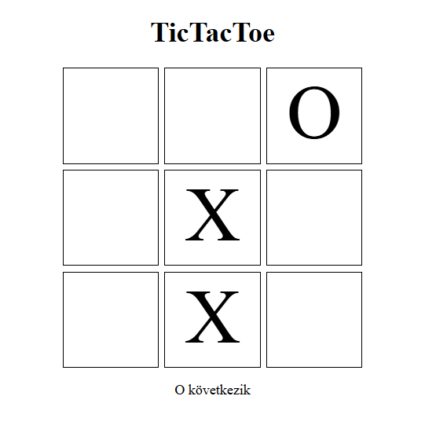

# Tic-tac-toe

## A megoldás lépései

Csatold a js fájlt a html-be!

### 1. feladat: készítsd el a játékteret!

1.1 Fogd meg a .jatekter classnévvel ellátott elemet.
1.2 Készíts függvényt init() néven!
1.3 Hozz létre benne egy változót htmlKod néven és helyezd el benne a html kódot. (9 div. classnevük legyen az "elem")
1.4 illeszd be a jatéktérbe insertAdjacentHTML segítségével

###  2. feladat Kattintás események kezelése

2.1 Fogd meg a div-eket!
2.2 Minden egyes divre rakj eseménykezelőt! (ciklus) 
2.3 Ha egy divre kattintunk, akkor a div adjon magáról információt (hányadik div-re kattintottunk? Ehhez érdemes id-t is adni a diveknek a classnéven kívül.)
2.4 A kiválasztott divbe írjunk x, vagy o jelet! (honnan tudjuk, hogy most x vagy o következik? ) 

###  3. feldat győzelem ellenőrzése
A győzelem ellenőrzéséhez érdemes nem a div-ek tartalmát vizsgálni. 
Milyen adatszerkezettel modellezhetjük a játékunkat? 

